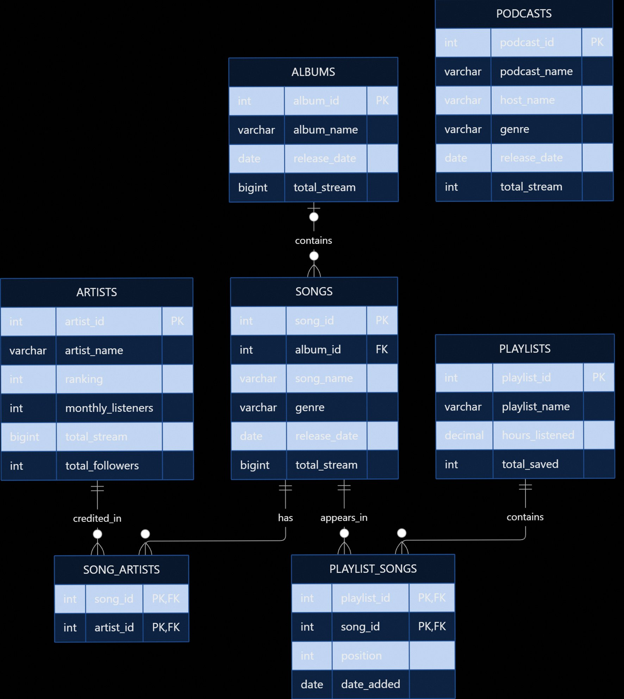

# Spotify Music and Podcast Database

A MySQL database for organizing artists, albums, songs, playlists,
and podcasts, with queries for exploring their popularity and
relationships.

Created as my final project for CS50 SQL.

## Overview

This project models a music and podcast collection using seven
relational tables. It supports artist collaborations, songs with
optional album associations, and playlists with ordered song entries.

The database stores information and statistics. It does not connect
to Spotify, play audio, or collect live listening data.

## Repository Files

| File | Description |
|---|---|
| `schema.sql` | Creates the database, tables, and constraints |
| `sample_data.sql` | Inserts fictional data for trying the queries |
| `queries.sql` | Contains 15 example queries |
| `diagram.png` | Shows the entity relationship diagram |
| `README.md` | Explains the project and setup instructions |

## Features

- Store artist rankings, monthly listeners, streams, and followers.
- Organize songs by album, genre, and release date.
- Credit multiple artists on the same song.
- Add songs to playlists and record their order and dates added.
- Store podcast information and stream counts.
- Find popular content and count songs in albums and playlists.

## Database Structure

| Table | Purpose |
|---|---|
| `artists` | Artist details and popularity statistics |
| `albums` | Album names, release dates, and stream counts |
| `songs` | Song details and optional album associations |
| `song_artists` | Artist credits for each song |
| `playlists` | Playlist names, listening hours, and save counts |
| `playlist_songs` | Playlist contents, positions, and dates added |
| `podcasts` | Podcast names, hosts, genres, and stream counts |

### Entity Relationship Diagram



An album can contain many songs. Each song can belong to one album
or have no album assigned.

Songs and artists have a many-to-many relationship through
`song_artists`. This supports collaborations without duplicating
song records.

Songs and playlists have another many-to-many relationship through
`playlist_songs`. A song can appear in several playlists, but only
once in each playlist.

Podcasts are independent of the other tables. Each podcast record
represents a whole show rather than an individual episode.

### Data Integrity

- Auto-incrementing primary keys identify records.
- Foreign keys ensure that related records exist.
- Composite primary keys prevent duplicate artist credits and
  duplicate songs within a playlist.
- `UNIQUE (playlist_id, position)` prevents two songs from occupying
  the same position in one playlist.
- Check constraints require nonnegative listening hours and
  playlist positions of at least 1.
- Unsigned integer types prevent negative counts.

Deleting an album sets its songs' album IDs to `NULL`, preserving
the songs. Deleting a playlist removes its playlist entries without
deleting the songs themselves.

## Getting Started

### Requirements

- MySQL 8.0.16 or later
- MySQL Workbench or the MySQL command-line client

MySQL 8.0.16 or later is needed to enforce the `CHECK` constraints.

### Setup

Clone the repository and enter its folder:

```bash
git clone https://github.com/aminh2601/Spotify-Database.git
cd Spotify-Database
```

Run the following commands from a terminal with the MySQL client
available. Replace `root` if you use another MySQL username.

#### 1. Create the database and tables

```bash
mysql -u root -p < schema.sql
```

#### 2. Load the sample data

```bash
mysql -u root -p spotify < sample_data.sql
```

#### 3. Run the example queries

```bash
mysql -u root -p spotify < queries.sql
```

Each command prompts for your MySQL password.

Alternatively, open the files in MySQL Workbench and execute them
in the same order.

Run the schema on a fresh database and load the sample data once.
The scripts do not reset existing tables or replace existing rows.

## Sample Data

All names and statistics in `sample_data.sql` are fictional.

The dataset includes:

- 4 artists
- 4 albums
- 10 songs
- 4 playlists
- 3 podcasts

It also includes a collaboration, a song without an assigned album,
an empty album, and an empty playlist. These examples demonstrate
many-to-many relationships, nullable foreign keys, and queries that
include records without related entries.

## Example Queries

`queries.sql` includes queries for:

- Artists ordered by monthly listeners
- Top 10 most streamed songs and albums
- Songs with their album names and artist credits
- Songs by Luna Grey
- Song counts for each album, artist, and playlist
- Distinct album counts for each artist
- Songs in playlist order
- Playlists ordered by saves
- Songs filtered by genre or release year
- Podcasts ordered by streams

### Most Streamed Songs

```sql
SELECT song_name, total_stream
FROM songs
ORDER BY total_stream DESC
LIMIT 3;
```

With the supplied sample data, the expected result is:

| song_name | total_stream |
|---|---:|
| After Midnight | 900000 |
| Bloom Again | 750000 |
| Homebound | 700000 |

### Songs in a Playlist

```sql
SELECT playlist_songs.position, songs.song_name
FROM playlist_songs
JOIN songs
    ON playlist_songs.song_id = songs.song_id
WHERE playlist_songs.playlist_id = 1
ORDER BY playlist_songs.position;
```

Expected result:

| position | song_name |
|---|---|
| 1 | After Midnight |
| 2 | Stay Awhile |
| 3 | Homebound |
| 4 | Neon Streets |
| 5 | Bloom Again |

Artist names, playlist IDs, genres, and dates in the example queries
can be changed to explore other records.

## Design Choices

Names are not unique identifiers because different artists, songs,
or albums may share a name. Numeric primary keys distinguish them.

Association tables represent artist credits and playlist contents.
This avoids storing lists of IDs or names inside a single column.

Stream counts use `BIGINT UNSIGNED` to accommodate large values.
Listening hours use `DECIMAL(10, 2)` to store two decimal places,
while release dates and dates added use `DATE`.

Statistics are stored directly rather than calculated from listening
events. In the sample data, collaboration streams count in full
toward each credited artist's total.

## Limitations

- Statistics require separate updates, and the database does not
  keep their history.
- A song can belong to only one album.
- Each song and podcast has one genre field.
- Podcast hosts are stored as text rather than separate entities.
- A song cannot appear more than once in the same playlist.
- Playlist positions must be unique and positive, but they do not
  have to be consecutive.
- There are no user accounts, playlist owners, individual podcast
  episodes, audio files, or playback features.
